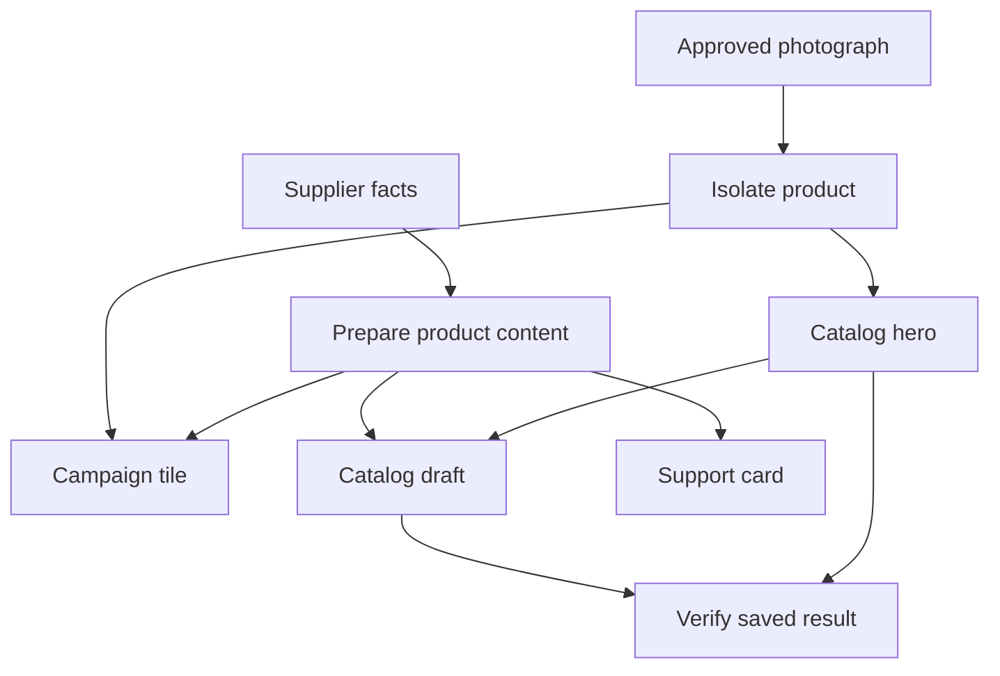

# Workflow Atlas — Build Plan

Build two systems with a vendor boundary between them.

Saltbreak Surf Co. is the fictional customer: an independent SMB surf shop selling surfboards, beach gear, and surf apparel through its own storefront and staff operations. It exists and transacts whether or not Atlas exists.

Workflow Atlas is the product: it maps Saltbreak's work across catalog operations, creative production, and customer support; recommends concrete improvements; turns demonstrations into reusable skills; and runs those skills through Meta models and computer use — always through Saltbreak's real interfaces, never through a backdoor.

The first complete workflow is: an approved supplier package becomes a verified catalog draft, a reusable product cutout, and a campaign image. A support knowledge card is the first extension. The map connects each task to its inputs, outputs, demonstrations, skill versions, and execution evidence.

The two systems keep separate code, separate databases, and separate UI. Atlas never imports Saltbreak's data layer; it only sees what its worker observes through Saltbreak's interfaces, exactly as a human employee would.

Implementation window: October 30 through November 4, 2026, using America/New_York dates and the hackathon deadline supplied in the conversation. Build the execution path first, then connect the graph and adviser to its real evidence.

# Product scope and completion criteria

The minimum version must let a user complete this sequence:

1. Open the fictional company map and inspect the product onboarding workflow.
2. Review an automation recommendation and its supporting evidence.
3. Record a person completing a bounded task in the sandbox.
4. Review the proposed procedure, including variable bindings and unresolved rules.
5. Save a versioned skill.
6. Execute it on a different product.
7. Inspect real generated assets and a persisted catalog draft.
8. Replace a source image and refresh only affected outputs.
9. Change a procedure rule, create skill version 2, and rehearse it.

## Required for the submission

| Capability | Deliverable |
| - | - |
| Working ecommerce sandbox | Supplier Hub, Catalog Admin, and a rendered draft preview backed by persistent records |
| Real Meta integration | Muse interpretation and computer use, plus SAM product segmentation |
| Recorded teaching | Ordered events, application context, screenshots at meaningful transitions, and user annotations |
| Reusable skill | Typed JSON, readable instructions, input bindings, checks, provenance, and versions |
| Execution | A new product processed through the actual browser interface |
| Verification | Saved record, field values, asset identity, image specifications, and draft state checked |
| Company graph | Three functions and approximately eight to twelve tasks, with evidence and dependency details |
| Advice | Grounded recommendations with a concrete next action |
| Regeneration | Image change causes selective output refresh |
| Skill revision | One bounded procedure change produces a tested new version |

## Saltbreak business scope

Saltbreak is live and transacting in three areas: supplier intake (packages arrive, facts get normalized), catalog staging (drafts become listings), and asset preparation (cutouts, hero, campaign images).

Backdrop systems with real cause-effect loops: orders, inventory, a support inbox, an email outbox (queued/sent, nothing actually delivered), customer records with segments, and an append-only business event log that every subsystem writes to. Payments and shipping carriers are implied as fields and statuses (for example `payment: captured (simulated)`), never built. Atlas reads the event log to find opportunities; it never queries business tables directly.

Required business causality:

1. Checkout creates an order and decrements inventory; insufficient stock blocks checkout.
2. Publishing a draft makes it live on the storefront; unpublishing removes it.
3. Zero stock shows "Sold out" and disables add-to-cart.
4. Publishing requires complete dimensions; the Woven beach tote cannot publish until its dimensions exist. This is the demo hook Atlas resolves.

## First extension

Add a support knowledge card derived from approved product facts. This strengthens the shared-data story, but it follows the complete catalog workflow.

Additional commerce operations, native desktop applications, continuous background monitoring, arbitrary website support, and multiple concurrent operators belong after the hackathon. Keep the initial operating scope to product content and draft preparation.

# Fictional company and test data

Saltbreak Surf Co. has three functions:

| Function | Responsibility | Work represented in the graph |
| - | - | - |
| Catalog operations | Maintain accurate product content | Review supplier package, normalize facts, stage catalog draft, verify listing |
| Creative production | Prepare product assets | Resolve approved image, isolate product, generate hero image and campaign tile |
| Customer support | Maintain useful product references | Prepare a sourced product knowledge card and refresh it after factual changes |

Use six deliberately different product fixtures:

| Product | Purpose | Seed state |
| - | - | - |
| Drift 8'0" foam surfboard | Teaching example with one clear subject | Live on storefront, 12 in stock |
| Reef 6'2" shortboard | New-input execution with different dimensions and materials | Draft, ready to publish |
| Côte beach towel | New-input execution with accented text and a longer description | Live on storefront, 20 in stock |
| Carbon SUP paddle | Thin shaft and blade detail for mask review | Live on storefront, 8 in stock |
| Woven beach tote | Missing required dimensions and missing optional care information | Draft, blocked from publishing |
| Two-board beach photograph | Ambiguous subject selection that requires clarification | Unlisted, needs subject selection |

Seed three to four orders in varied states, inventory rows for live products, and three support tickets (sizing, shipping, and a care question for the tote that references its missing care information).

Beyond these six test fixtures, the catalog carries additional depth products (apparel, accessories, more boards and gear, currently eight listings live) so the storefront reads as a real shop. Every fixture ships an AI-generated placeholder photograph under `fixtures/saltbreak/<sku>/photo-1.jpg`, referenced by the manifest's `approvedImageRef` and duplicated under the storefront's public directory for serving.

Each supplier package contains a short specification document, one or two source photographs, a manifest with SKU and approved image reference, and declared product facts. Store facts, source images, approval references, and image specifications as separately versioned inputs.

The required catalog fields are SKU, title, category, material, color, dimensions with units (e.g. board length × width × thickness), description, primary image, image alt text, and draft status. Care instructions (e.g. board storage, wetsuit rinse) are optional and remain explicitly unavailable when absent. Maintain expected results in a separate evaluation fixture that the executing agent cannot read.

Use original or appropriately licensed images and retain their origin in the fixture manifest. Label the company data as synthetic. Record demonstrations in the working sandbox during development. Distinguish authored examples from observed recordings.

Proposed demo image specifications:

- Catalog hero: 1600 by 1600 pixels, white background, complete product visible, defined padding, JPEG.
- Product cutout: transparent PNG at sufficient source resolution.
- Campaign tile: 1200 by 1500 pixels, fixed neutral template, product title from approved facts, PNG.

These are Saltbreak demo requirements, not marketplace requirements.

# User interface and routes

Use one repository with two applications. Saltbreak is the customer's system; Atlas is the product. Saltbreak must behave like a real business: forms validate, checkout creates orders and decrements stock, publishing changes the storefront, saves persist, and refresh reloads saved state.

Saltbreak storefront and staff routes:

| Route | Purpose | Essential interaction |
| - | - | - |
| / | Storefront home | Browse featured live products |
| /shop | Catalog | List live products with stock status |
| /product/[sku] | Product page | View details, add to cart unless sold out |
| /cart | Cart | Adjust quantities, proceed to checkout |
| /checkout | Simulated checkout | Submit order, clear cart on success |
| /order/[id] | Confirmation | View the created order |
| /staff/supplier | Supplier intake | Browse supplier packages and approved images |
| /staff/catalog | Catalog staging | Create/update drafts, publish or unpublish |
| /staff/preview/ | Draft preview | Render the actual saved draft |
| /staff/assets | Asset panel | Select a subject, preview the mask, generate variants |
| /staff/orders | Order list | Review orders and their items |
| /staff/inventory | Inventory | Review and adjust stock levels |
| /staff/inbox | Support inbox | Review and resolve tickets |
| /staff/customers | Customers | Segments and order history |
| /staff/outbox | Email outbox | Queued and sent mail |
| /staff/activity | Activity log | Business event stream |
| /staff/promos | Promos | Campaign windows |
| /staff/overview | Overview | Revenue, orders, tickets, stock |

Atlas product routes:

| Route | Purpose | Essential interaction |
| - | - | - |
| /atlas | Company overview | Expand a function, select a task, inspect evidence and opportunities |
| /atlas/inbox | Opportunity inbox | Review detected automations with evidence |
| /atlas/opportunities/ | Opportunity detail | Approve or reject, launch a supervised run |
| /workflows/ | Process detail | View tasks, inputs, outputs, unresolved rules, and related skills |
| /recordings/ | Teach a procedure | Start and stop recording, annotate a rule, mark a variable or completion condition |
| /skills/ | Review a skill | Edit bindings and checks, compare versions, run with new inputs |
| /runs/ | Inspect execution | Follow real events, view outputs, pause or take over, inspect checks |

The Atlas page uses a left function navigator, a central graph, and a right task inspector. Keep screenshots and detailed run logs in the inspector rather than putting every evidence record on the main graph.

Offer Process, Artifacts, and Evidence views of the same records. A task can be described, observed, or supported by tested skills. Display execution status separately. An old successful run can later have stale outputs.

Include three distinct actions: Run with new inputs, Refresh affected outputs, and Revise skill. Their histories should remain separate.

# Task graph and dependencies

The initial visible graph contains these tasks:

| Task | Requires | Produces |
| - | - | - |
| Read supplier package | Supplier specification | Structured product facts with source references |
| Resolve approved image | Manifest and source images | Approved image reference and subject-selection rule |
| Isolate product | Approved image and selection | Segmentation mask and reusable cutout |
| Prepare catalog hero | Cutout and hero specification | Catalog hero image |
| Prepare campaign tile | Cutout, approved title, and campaign template | Campaign image |
| Create catalog draft | Product facts and hero image | Persisted draft |
| Prepare support card | Product facts and support template | Product knowledge card |
| Verify outputs | Current inputs, artifacts, and saved draft | Check results and evidence |



Represent functions, tasks, applications, sources, artifacts, skills, skill versions, runs, and evidence in storage. The graph is a view of these records.

Use typed edges: contains, uses, consumes, produces, depends_on, implemented_by, and supported_by. Apply cycle checks to the data-flow and execution dependencies, not indiscriminately to all relationship types.

Evidence status per task: Described (in company brief), Observed (recorded demonstration), Needs clarification (uncertain dependency or rule), or Tested skill available (reusable procedure passed defined cases).

Each inferred task or dependency carries a source reference and a status. Explicit application metadata, demonstrated data transfers, documented rules, and user confirmation can support a dependency. Merely viewing two pages in sequence is insufficient proof that one output depends on the other.

Store the proposed graph update as a reviewable change. Validate node references and edge types before committing it. Preserve user corrections. Reuse an existing task only when its intent and input/output contract match, rather than because its button labels look similar.

# Technical architecture

Use a TypeScript application with a local browser worker.

| Layer | Choice | Responsibility |
| - | - | - |
| Saltbreak app | Next.js, React, TypeScript, Tailwind | Storefront, cart, checkout, and staff operations |
| Atlas app | Next.js, React, TypeScript, Tailwind | Company graph, skill editor, run viewer |
| Graph | React Flow | Grouped functions, task nodes, dependency edges, selection and inspection |
| Agent coordinator | Eve | Interpret requests, retrieve skills, call typed tools, and report progress |
| Orchestration model | Muse Spark 1.3 through a configured compatible provider | Task interpretation, advice, and skill proposals |
| Computer-use model | Muse Wonder through a direct Meta Responses client | Current-screen decisions and browser actions |
| Segmentation | SAM 3.1 through a direct Meta client | Product masks |
| Browser worker | Long-lived Node process and Playwright Chromium | Recording, screenshots, serial execution, uploads, and checkpoints |
| Image processing | Sharp | Apply mask, create cutout, resize, pad, composite, and export |
| Saltbreak records | SQLite with a typed data-access layer | Products, drafts, sources, orders, inventory, tickets |
| Atlas records | Separate SQLite database with a typed data-access layer | Inputs, graph relationships, skills, runs, and evidence |
| Evidence and assets | Local files with database references | Screenshots, masks, images, recordings, and exports |
| Progress transport | Server-sent events | Stream persisted run events into the UI |

React Flow supports custom nodes and edges suitable for the graph. See the [React Flow guide](https://reactflow.dev/learn). Sharp provides image composition operations; see its [compositing reference](https://sharp.pixelplumbing.com/api-composite/).

## Provider boundary

Eve accepts a configured AI SDK model instance for direct providers; a model string routes through its gateway. Use an OpenAI-compatible provider configured for Meta's base URL and the actual Meta model identifier. Validate text and function calling before building features on that adapter. See [Eve agent configuration](https://eve.dev/docs/agent-config) and the [compatible provider documentation](https://ai-sdk.dev/providers/openai-compatible-providers).

Keep SAM and the native computer protocol in a direct Meta client inside the worker. Their specialized Responses payloads should not depend on the ordinary chat adapter.

Eve requires Node.js 24 or newer. Start from its initializer during implementation and read the documentation shipped with the installed version. See [Eve setup](https://eve.dev/docs/getting-started).

## Runtime boundary

Run one active operator per browser context. The UI, coordinator, and worker can run locally on the Mac. Keep browser ownership in the worker so request lifetimes do not control an active browser session.

Each application owns its own records. The worker reports evidence and outcomes through Atlas's service. Saltbreak's staff tools perform their real writes through Saltbreak's normal interface. The agent does not receive a privileged tool that silently writes the finished catalog record or touches Saltbreak's database directly.

Use a read-only verification path for inspecting the persisted result. Keep evaluation answer files outside the agent's available sources.

A hosted UI can be added later, but a live hosted execution needs an appropriately hosted worker and shared storage. A serverless UI route does not provide control of the Mac's browser.

# Data model

Start with relational records and adjacency tables. A graph database and vector index are unnecessary for the initial task count.

| Entity | Minimum fields |
| - | - |
| Company and function | id, name, declared responsibilities |
| Application | id, name, allowed origin and routes |
| Task | id, functionId, purpose, input/output contract, evidence status |
| Edge | fromId, toId, type, sourceEvidenceIds, proposed or confirmed status |
| Source version | sourceId, version, content hash, type, normalized data or file reference |
| Recording | id, goal, actor mode, application scope, start/end times |
| Recording event | recordingId, sequence, event type, target description, value, screenshot reference |
| Skill | id, name, active version |
| Skill version | immutable version, recipe JSON, readable instructions, input schema, recording references |
| Run | id, skillVersionId, pinned inputs, execution status, operation key, checkpoints |
| Step attempt | runId, stepId, attempt, actions, observed outcome, verification results |
| Artifact version | logical artifactId, version, content hash, file reference, input versions, producer run |
| Evidence | source kind, referenced event/record/artifact, timestamp, relevant observation |
| Opportunity | taskIds, recommendation type, rationale, evidenceIds, prerequisites, next action |

Keep two separate status dimensions:

- Execution: queued, running, verifying, succeeded, paused, failed, cancelled.
- Freshness: current, stale, blocked.

A successful historical run remains successful when a later input change makes its output stale.

Each artifact manifest records exact consumed source and artifact versions, relevant parameters, producer skill version, tool/model identifiers, and verification references. Keep source facts and source imagery separate so an image replacement does not invalidate unrelated text.

Use a stable business key for a catalog target, such as company plus SKU. Use a separate run key for the skill version and exact input versions. The first prevents duplicate products; the second detects duplicate executions of the same request.

# Recording and skill compilation

## Capture a bounded demonstration

The user names a task, selects the sandbox, and starts recording. Capture navigation, clicks, committed input changes, selections, file uploads, form submission, and significant resulting states. Record the final field value rather than every keystroke.

Include the target's accessible role and label, relevant surrounding text, record identity, and bounding box. Save screenshots around meaningful transitions. Capture typed-tool calls from the asset panel as part of the same demonstration.

Playwright's context initialization scripts and exposed bindings can install and collect browser events. See the [BrowserContext API](https://playwright.dev/docs/api/class-browsercontext).

Distinguish human demonstration events from agent execution events. Restrict collection to the selected workspace; omit passwords, tokens, and unrelated browser activity.

Let the demonstrator annotate three useful things: this value varies, this is a business rule, and this outcome proves completion.

## Compile the demonstration

Send Muse the declared goal, normalized events, selected screenshots, source definitions, and output requirements. Request a structured proposal containing tasks, parameter bindings, checks, and unresolved assumptions.

Validate the proposal against a local schema and registered tool capabilities. Meta documents JSON-schema-constrained output, but schema conformity does not establish the correctness of the procedure; the user review and execution checks supply that evidence. See [Meta structured output](https://dev.meta.ai/docs/structured-output).

The review screen should show substitutions explicitly:

- The demonstrated product title ("Drift Foam Surfboard") becomes product.title.
- The demonstrated SKU ("SB-BOARD-001") becomes product.sku.
- The demonstrated material ("Foam") becomes product.material.
- Draft status remains a fixed rule.
- A photograph click is attached to that source image version, not reused at the same pixels in every new photo.

One demonstration supplies one observed path. An exception branch needs a documented rule, a further example, or explicit user instruction.

## Skill representation

Use a restricted typed recipe as the execution source of truth. Generate the readable skill from the same version. Supported step kinds are read_source, transform, tool, computer_task, verify, and review.

Minimum skill fields are identity/version, goal, input schema, preconditions, source bindings, steps, allowed applications and tools, output schema, completion checks, recovery limits, and evidence.

Abridged example:

```json
{
  "schemaVersion": 1,
  "id": "prepare-catalog-draft",
  "version": 1,
  "inputSchemaRef": "CatalogJobInput",
  "steps": [
    {
      "id": "isolate-product",
      "kind": "tool",
      "toolId": "segment_product",
      "bindings": {
        "assetId": "inputs.approvedImageId",
        "concept": "inputs.productKind"
      }
    },
    {
      "id": "stage-draft",
      "kind": "computer_task",
      "applicationId": "catalog",
      "goal": "Create or update the draft for the supplied SKU using the prepared facts and hero image.",
      "dataRefs": ["productFacts", "catalogHero"],
      "checks": ["sku_matches", "fields_match", "hero_matches", "status_is_draft"]
    }
  ]
}
```

Implement validators for every referenced check and tool. Do not execute arbitrary model-generated JavaScript as a recorded skill.

Keep the generated business recipes in the application database and retrieve them by ID. A static Eve instruction skill can explain how the operator uses them. Eve skills add instructions rather than executable tools; tools must be registered separately. See [Eve skills](https://eve.dev/docs/skills).

Export a reviewed skill as readable instructions plus its recipe and tool requirements. Muse Code also supports project skill packages, providing a later integration target; see [Muse Code skills](https://dev.meta.ai/docs/muse-code/extending).

# Execution and verification

The coordinator creates a run pinned to a skill version and exact source versions. The worker obtains the appropriate browser session and performs each supported step.

The operator loop is: load skill version, pin input versions, inspect application state, execute the next supported step, capture resulting state, check the expected outcome, then continue, recover, pause, or fail.

For the computer-use portion, send a bounded goal, the current input values, and the current screenshot to Meta. Execute returned actions through the worker and return fresh state. Meta supplies the action protocol; the application supplies execution and verification. See [Meta computer use](https://dev.meta.ai/docs/computer-use).

Use a fixed browser viewport and align screenshot and mouse coordinate systems. Execute screen actions serially. Stop an action batch when navigation, an unexpected modal, or a failure invalidates its remaining actions.

For uploads, expose a scoped helper that can select only artifacts created or selected for the current run. The model still chooses the intended destination and upload step. File chooser mechanics do not require unrestricted filesystem access.

Recommended initial bounds are forty GUI actions per run, two recovery attempts per failed step, and a configurable run timeout. Treat these as prototype limits to tune using measured runs.

Recovery rules:

1. Missing or ambiguous source data pauses the run with the exact missing item.
2. A changed interface triggers a fresh observation within the current task scope.
3. An uncertain save result triggers inspection of the target record before another submission.
4. A restarted worker resumes from a checkpoint only after inspecting current state.
5. A duplicate run request returns its existing receipt or updates the existing SKU according to the declared rule.
6. Exhausted limits produce a failed or paused run with partial evidence.

Completion is decided by the verifier. Check the saved SKU, required field values, units, uploaded asset identity, image dimensions, draft state, and rendered preview. Read the persisted result after a refresh. A toast or the model's final message alone is insufficient.

Pin inputs at the start and check whether those inputs were superseded before reporting the result as current. Preserve the run's actual result even when newer source data arrives.

# SAM asset workflow

SAM's role is product isolation. Use the declared product kind (e.g. "surfboard", "paddle", "beach towel") as a text prompt when there is one clear subject. Offer a point or box correction when several subjects match or the result is unclear. Meta documents text, point, and box prompts that return masks and boxes; see the [SAM overview](https://dev.meta.ai/docs/sam/overview).

The pipeline is:

1. Normalize the image orientation and record its dimensions and hash.
2. Resolve the intended product using the approved source and selection rule.
3. Send the local source image as a supported base64 data URL, call SAM, and inspect the returned objects and diagnostics.
4. Decode the chosen mask with the official parser.
5. Apply it to the original image to create a transparent cutout.
6. Produce the hero and campaign image through deterministic templates.
7. Store the output files, input lineage, and visual preview.
8. Verify file properties and allow review of the subject and mask.

Meta accepts base64 image data URLs, which lets the local worker send image bytes without relying on a localhost URL being reachable by the API. See [SAM request formats](https://dev.meta.ai/docs/sam/segmenting).

The official parser provides raster masks and diagnostic information. Use the supported parser rather than assuming SAM returns a ready-to-upload PNG. See the [SAM client libraries](https://dev.meta.ai/docs/sam/client-libraries).

Store the cutout once and share it between downstream variants. A layout change to the campaign template should reuse the same cutout.

Selection coordinates are valid only for the image they describe. A new photograph requires a new selection decision. If two surfboards match and the approved manifest does not resolve which is intended, request selection instead of assuming that the largest mask is correct.

The source photograph, selected object, mask, and final composition remain inspectable. A nonempty mask proves neither correct identity nor acceptable edges. Keep thin structures (paddle shafts, leash cords, board rails), clipping, subject identity, and dimensions in the image review checks.

Use ordinary compositing to preserve the actual product's appearance. The first version does not need generated replacement product imagery.

# Automation adviser

Build recommendations from recorded work, supplied company rules, tool coverage, and verified runs. The first adviser can use a small rubric (repetition, structured inputs, clear output checks, supported applications, observed exceptions, shared dependencies, remaining human judgment) and ask Muse to explain its conclusions.

| Recommendation | Evidence in the demo | Action |
| - | - | - |
| Reuse product isolation | Hero and campaign tasks consume the same approved photo and selection | Create one cutout and share it |
| Automate catalog transfer | A demonstrated form mapping has structured inputs and explicit checks | Rehearse the catalog skill |
| Standardize source approval | Several files appear eligible but the approval reference is missing | Add an authoritative image reference |
| Collect another example | Missing-dimensions behavior is absent from the recording | Demonstrate or specify that branch |
| Assist visual review | A mask exists but subject selection or edges are uncertain | Show the preview for correction |

Each opportunity stores affected tasks, evidence IDs, expected change, prerequisites, unresolved questions, and a direct next action. Use readiness labels such as Ready to rehearse, Needs a rule, or Needs another example.

Do not invent company-wide automation percentages. If showing time estimates, distinguish observed active work, agent elapsed time, review time, and supplied workload assumptions.

The adviser should open the relevant evidence, recording flow, or skill editor. A conversational answer should leave the user with a concrete next operation.

# Regeneration and skill revision

## Refresh outputs after an input change

Store new source versions immutably. Compare meaningful normalized inputs, then traverse confirmed data dependencies. Mark affected outputs stale and show why. Run affected steps in dependency order and promote replacement outputs only after their checks pass.

Three required demonstrations of dependency behavior:

| Change | Refresh | Reuse |
| - | - | - |
| Approved source photo replaced | Mask, cutout, hero, campaign tile, catalog image, affected verification | Product facts and text-only support card |
| Product dimensions corrected | Catalog dimension fields, support card if implemented, affected verification | Cutout and images |
| Campaign layout specification changed | Campaign tile and its checks | Cutout, catalog hero, and catalog facts |

Include template, parameter, tool, and model identifiers in the artifact manifest. Explain staleness with a concrete message such as: Catalog hero used image version 1; approved image is now version 2.

Retain the old output while generating a replacement. A failed refresh should leave an inspectable previous result and a clear stale status.

## Revise the procedure

An input substitution does not require a new skill version. A changed operation, binding strategy, required check, or business decision does.

For the required revision example, add an explicit alt-text verification step that was absent from version 1. Save the edited recipe as version 2 and rehearse it. Earlier runs remain pinned to version 1.

If time permits, change the catalog's Category control from text input to dropdown. Capture a corrective demonstration, update the target interaction, and test the new skill. Treat this as a bounded repair example rather than a promise of universal automatic recovery.

Update the graph after verified runs with the skill version, output references, and execution evidence.

# Application tools and service contracts

The following names are proposed application tools, not Meta API endpoints.

| Tool | Inputs | Output |
| - | - | - |
| get_source | source ID and revision | Normalized values, content hash, evidence reference |
| compile_skill | recording ID and declared goal | Draft recipe, suggested bindings, unresolved rules |
| get_skill | skill ID and version | Validated recipe and readable instructions |
| segment_product | asset ID, concept or selection, operation key | Mask and cutout references |
| prepare_image_variants | cutout ID and specification versions | Hero and campaign artifact references |
| run_skill | skill version, bound inputs, source versions, operation key | Run receipt |
| get_run | run ID | Status, events, checks, outputs, failure reason |
| inspect_impact | source ID and new revision | Affected outputs and dependency reasons |
| verify_result | run ID and expected contract | Observed values, check results, evidence |
| revise_skill | existing version and reviewed changes | New immutable draft version |

Tools validate identifiers and scope before executing. The model may select a registered capability and provide arguments; it does not define new execution privileges through page content.

Persist events such as recording.started, skill.draft_created, run.started, step.started, action.executed, artifact.created, check.failed, run.succeeded, and output.stale. The UI consumes actual persisted events rather than advancing on a timer.

Keep fixture and live model modes explicit. Development fixtures can support UI work, but live completion evidence must come from real calls and browser execution.

# Implementation sequence

Use the earliest tasks to test the dependencies that determine whether the concept works.

| Date | Deliverable | Exit condition |
| - | - | - |
| October 30 | Scaffold, provider checks, minimal catalog form, one SAM result, one native computer-use round trip | Real Meta calls work and a draft can be saved and read back |
| October 31 | Supplier and catalog sandbox, recording, input schema, skill compilation and review | A demonstration produces an editable recipe tied to its evidence |
| November 1 | Replay on a new product, scoped upload, persistence checks, duplicate prevention | A new SKU is processed correctly from the learned recipe |
| November 2 | Company graph, evidence inspector, recommendations, shared cutout, source versions | An opportunity links to evidence and a working skill; an image change identifies affected outputs |
| November 3 | Selective refresh, skill version 2, failure scenarios, run viewer polish | Regeneration and revision work with inspectable history |
| November 4 | Freeze features, final scenario run, three-minute video, README and submission | Reproducible demo and complete submission materials |

## Gate zero

Verify four things before elaborate graph work:

1. Eve can call the configured Meta model for a text response and one function-call round trip.
2. The direct Meta client can obtain a SAM mask for a fixture image.
3. The browser worker can execute a native computer action and return a fresh screenshot.
4. A saved draft survives refresh and can be independently verified.

The Eve and Meta combination is an integration to validate during this gate. If it fails, isolate the provider adapter and resolve the mismatch. Preserve the user's Meta model requirement.

## Build order within the first workflow

Create the data fixtures and minimal sandbox. Add the worker, direct clients, image transformation, and verifier. Prove a manually specified recipe first and label it as authored. Then build recording and compilation, replace the authored recipe with one derived from a demonstration, and execute a new product.

After that, connect graph views, recommendations, and regeneration to the actual records and runs.

## Scope order if time tightens

Preserve real SAM output, real browser execution, one learned skill, a new-input run, independent verification, a small evidence-backed graph, one grounded recommendation, image refresh, and an edited skill version.

Add the support card, autonomous interface repair, richer graph editing, narration transcription, additional companies, and hosted execution only after that path is reliable.

# Acceptance tests

Run a compact scenario suite that resolves the project's real risks.

| Scenario | Required result |
| - | - |
| Teaching example | Human events produce a readable, editable skill with correct bindings |
| New shortboard | Correct SKU, facts, images, and saved draft without copied surfboard values |
| Accented towel | Text preserved and fields mapped correctly |
| Missing required dimensions | Run pauses with the missing fields; dimensions are not invented |
| Missing optional care text | Field stays unavailable or omitted according to the template |
| Two products in one photo | Explicit subject selection or a clear paused state |
| Thin paddle structures | Mask remains inspectable; obvious clipping prevents automatic visual acceptance |
| Repeat execution | Existing logical SKU is updated or the existing receipt is reused; no unintended duplicate |
| Unclear save response | Saved state is inspected before any retry |
| Source photo change | Image-dependent outputs refresh; unrelated facts remain current |
| Dimension correction | Relevant text and checks refresh; segmentation is reused |
| Skill version 2 | Added verification rule is applied; prior run history is preserved |
| Persisted result | Preview reads the saved record after refresh |
| Evidence integrity | Every success badge and observed recommendation links to supporting data |

Keep the current source contract and independent expected fixture values available to the verifier, not as hidden answer shortcuts for the executing agent.

Report the number of attempted cases, completed cases, pauses, failures, manual interventions, duplicate writes, and relevant field checks. Record latency and model usage from actual runs. A six-product fixture suite is a prototype gate, not a general reliability claim.

For the final run, require the ordinary new-input cases, duplicate prevention, image refresh, and skill revision to pass. Unsupported cases must stop clearly rather than fabricate completion.

# Repository organization and developer handoff

Suggested areas within one repository:

| Area | Contents |
| - | - |
| apps/saltbreak | Customer system: storefront, cart, checkout, staff operations |
| apps/atlas | Product interface: company graph, skills, runs, adviser |
| apps/agent | Eve configuration, static operating instructions, registered tools |
| apps/worker | Playwright session manager, recorder, computer-use loop, checkpoints |
| packages/contracts | Shared schemas for graph entities, skills, events, runs, and checks |
| packages/saltbreak-data | Customer tables, repositories, and business seeding |
| packages/atlas-data | Atlas tables, repositories, and graph seeding |
| packages/meta | Ordinary model adapter and direct Responses clients |
| packages/assets | SAM parsing, masks, transformations, manifests |
| packages/verification | Field, artifact, persistence, and freshness checks |
| fixtures/saltbreak | Synthetic company brief, product packages, specifications |
| tests/scenarios | Independent expected outcomes and scenario runners |

Define commands for local development, fixture seeding, demo reset, scenario evaluation, and production build. Pin working dependency versions in the lockfile. A reset command should clearly target the synthetic sandbox only.

Keep model credentials on the server and worker. Configure the Meta base URL and model IDs centrally. Use [https://api.meta.ai/v1](https://api.meta.ai/v1) with MODEL_API_KEY. Start with muse-spark-1.3 for orchestration, muse-wonder-1.0 for computer use, and sam-3.1 for segmentation, subject to the access checks in gate zero. Keep live and fixture execution modes separate. These model roles follow the [Meta model documentation](https://dev.meta.ai/docs/models).

The initial coding-agent assignment is:

```text
Build Saltbreak Surf Co. as an independent fictional business, then the
first vertical slice of Workflow Atlas operating on it.

Saltbreak needs a real storefront (browse, cart, simulated checkout that
creates orders and decrements inventory), staff tools for supplier intake
and catalog staging with publish/unpublish driving the storefront, plus
seeded orders, inventory, and support inbox with working stock rules.

Then add a local browser worker and direct Meta clients for SAM and
computer use. Prove that a product image can be segmented, composed into
a hero asset, uploaded through the catalog interface, saved, and
independently verified.

Then record a human demonstration, compile it into a typed and editable
recipe, and run that recipe on a different product. Preserve input
bindings, evidence, completion checks, and version history.

Use the implementation gates in this specification. Make live and fixture
execution modes visible. Connect the graph and recommendations to actual
recordings and outcomes. Keep browser execution serial and verify saved
state before reporting success.
```

This is a development handoff; it does not require building every proposed screen before proving the first complete run.

# Demo and submission

The demo should show the connection between company understanding and a working skill.

| Time | Scene |
| - | - |
| 0:00 to 0:20 | Saltbreak storefront and staff ops: a real business with orders and stock |
| 0:20 to 0:40 | Company map, product onboarding task, and recorded evidence |
| 0:40 to 1:00 | Recommendation to reuse product isolation and automate catalog staging |
| 1:00 to 1:25 | Teaching excerpt, proposed skill, and one binding or rule correction |
| 1:25 to 2:05 | New-product execution, real SAM result, browser form work, saved draft |
| 2:05 to 2:25 | Published listing live on the storefront, verification results |
| 2:25 to 2:45 | Source image replacement and selective refresh |
| 2:45 to 3:00 | Skill version 2 and the updated task graph with run evidence |

Use edited footage of actual execution if the full run exceeds the video length. Label elapsed time or speed changes. Keep source inputs, resulting records, and evidence inspectable.

Prepare the public repository, setup instructions, synthetic-data reset, environment example without secrets, dependency and asset credits, known supported scenarios, and the required three-minute video. Clearly identify the work created during the event.

The first build milestone is a correctly saved draft for a new SKU, created through genuine Meta-driven browser interaction using a real SAM-derived image. Every later feature should make that result easier to understand, reuse, or maintain.
